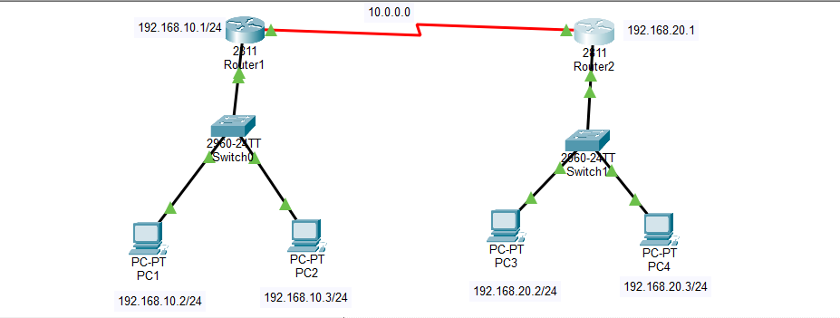
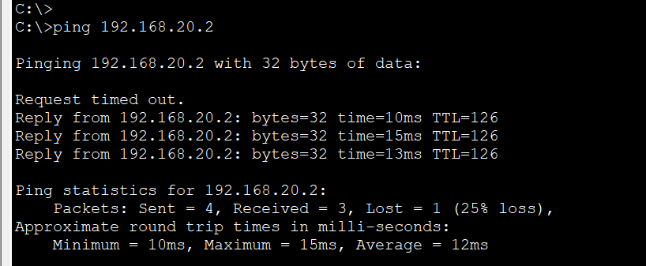
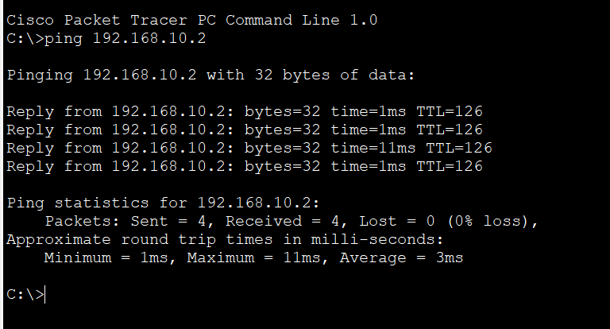
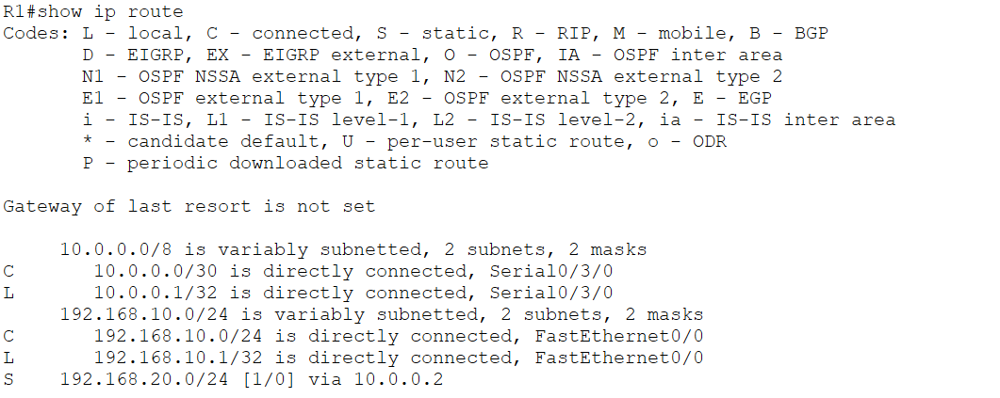
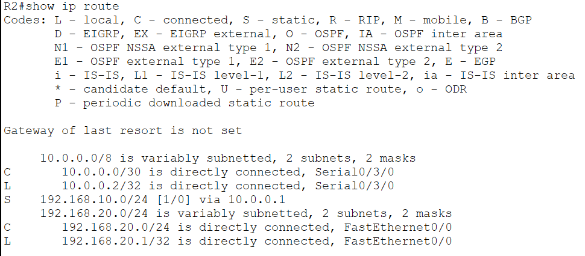

# 🌐 Week 01 – CCNA Networking Internship

<p align="center">
  
  
  
</p>

<p align="center">
  <b>Organization:</b> TechBiz Academy<br>
  <b>Intern:</b> Tahir Mehdi<br>
  <b>Student ID:</b> TBS-2026-2582<br>
  <b>Program:</b> CCNA Networking Internship
</p>

---

## 📌 Week 01 – Task 01

### Build Your CCNA Lab + How Networks Actually Work

| Detail | Information |
|---|---|
| Task Date | 10 November 2026 |
| Submission Deadline | 12 November 2026 |
| Lab Platform | Cisco Packet Tracer |
| Focus Areas | Networking Fundamentals, IP Addressing, Routing & Switching |

## 🎯 Task Overview

The objective of this task was to build a basic network topology using Cisco Packet Tracer and understand how computer networks communicate.

I designed and configured a small network consisting of **2 routers, 2 switches, and 4 PCs**. The practical exercise involved IP addressing, router and switch configuration, routing between separate networks, and connectivity verification.

## 🖥️ Network Topology

### Devices Used

| Device | Quantity |
|---|---:|
| Cisco Routers | 2 |
| Cisco Switches | 2 |
| PCs | 4 |
| **Total Devices** | **8** |

### Network Design

- **LAN 1:** PC1, PC2, Switch 1 and Router 1
- **WAN Link:** Router 1 connected to Router 2 through serial interfaces
- **LAN 2:** PC3, PC4, Switch 2 and Router 2

### Network Topology Diagram

<p align="center">
  
</p>

## 🌐 IP Addressing Configuration

| Device | Interface | IP Address |
|---|---|---|
| Router 1 | Serial 0/3/0 | 10.0.0.1 |
| Router 2 | Serial 0/3/0 | 10.0.0.2 |

**Subnet Mask:** 255.255.255.252 (/30)

The remaining LAN addressing and device configurations are documented in the practical lab report.

## ⚙️ Practical Activities

- Created a network topology in Cisco Packet Tracer.
- Connected two routers using serial interfaces.
- Configured IP addresses on router interfaces.
- Configured switches and end devices.
- Practiced routing between separate networks.
- Tested connectivity using ICMP ping.
- Used Cisco IOS verification commands.
- Studied how packets travel between two hosts.

## 💻 Cisco IOS Configuration

### Router Interface Configuration

```cisco
enable
configure terminal
interface serial 0/3/0
ip address 10.0.0.1 255.255.255.252
no shutdown
```

### Verification Commands

```cisco
show ip interface brief
show ip route
show running-config
```

## 🔄 Network Packet Journey

The packet travels from PC1 to PC4 through the following network devices:

```text
PC1
 |
Switch 1
 |
Router 1
 |
Router 2
 |
Switch 2
 |
PC4
```

This practical exercise helped me understand how switches forward Ethernet frames within a LAN and how routers forward IP packets between different networks.

---

## 📸 Practical Screenshots & Verification

The following screenshots document the network topology, connectivity tests, and Cisco IOS verification results.

### 1. Network Topology

<p align="center">
  
</p>

### 2. Ping Connectivity Tests

**PC1 – Connectivity Test**

<p align="center">
  
</p>

**PC4 – Connectivity Test**

<p align="center">
  
</p>

### 3. Router Interface Verification

**Router 1 – show ip interface brief**

<p align="center">
  
</p>

**Router 2 – show ip interface brief**

<p align="center">
  
</p>

### 4. Routing Table Verification

**Router 1 – show ip route**

<p align="center">
  
</p>

**Router 2 – show ip route**

<p align="center">
  
</p>

---

## 📄 Practical Lab Report

The complete practical documentation, including lab configuration, network design, and verification evidence, is available below.

<p align="center">
  <a href="Lab-Report.pdf">
    
  </a>
</p>

<p align="center">
  <b>📑 Lab-Report.pdf</b><br>
  Complete practical documentation
</p>

## 📥 Download Cisco Packet Tracer Project

The original Cisco Packet Tracer project is included in this repository.

<p align="center">
  <a href="Week1-Task1.pkt">
    
  </a>
</p>

**File:** `Week1-Task1.pkt`

You can download the project and open it using Cisco Packet Tracer to explore the network topology and device configurations.

## 📂 Repository Structure

```text
Week-01/
│
├── README.md
│
├── Lab-Report.pdf
│
├── Week1-Task1.pkt
│
└── Screenshots/
    ├── Topology.png
    ├── Ping-Test-On-PC1.png
    ├── Ping-Test-On-PC4.png
    ├── Show-Ip-interface-brief-Router1.png
    ├── Show-Ip-interface-brief-Router2.png
    ├── Show-ip-route-of-Router1.png
    └── Show-ip-route-of-Router2.png
```

## 🎓 Learning Outcomes

Through this practical task, I strengthened my understanding of:

- Networking Fundamentals
- Cisco Packet Tracer
- IPv4 Addressing and Subnet Masks
- Router and Switch Configuration
- Serial WAN Communication
- Routing Between Networks
- ICMP and Ping Testing
- Cisco IOS Verification Commands
- Basic Network Troubleshooting

## 📝 Conclusion

This was my first practical task in the TechBiz Academy CCNA Networking Internship. It provided hands-on experience in designing a network topology, configuring Cisco devices, and understanding communication between different networks.

The exercise strengthened my networking fundamentals and provided a practical foundation for learning more advanced CCNA concepts.

I look forward to completing upcoming internship tasks and continuously improving my networking and cybersecurity skills.

---

<p align="center">
  <b>Intern:</b> Tahir Mehdi<br>
  <b>Internship:</b> TechBiz Academy – CCNA Networking<br>
  <b>Focus:</b> Networking | Routing & Switching | Cybersecurity
</p>

<p align="center">
  <i>Learning by Building. Improving by Practicing.</i>
</p>