# 🌐 Week 1 – Task 3: The IOS Command Line, Interfaces and Recovery

<p align="center">

**TECHBIZ SECURITY**

**CCNA NETWORKING INTERNSHIP**

*Cisco IOS CLI | Interface Configuration | SSH | Password Recovery*

</p>

---

## 📌 Task Information

| Field | Details |
|---|---|
| Organization | TechBiz Security |
| Internship | CCNA Networking Internship |
| Week | Week 1 |
| Task | Task 3 |
| Task Title | The IOS Command Line, Interfaces and Recovery |
| Intern Name | Tahir Mehdi |
| Student ID | TBS-2026-2582 |
| Lab Environment | Cisco Packet Tracer / GNS3 / CML |
| Submission Date | 16 November 2026 |
| Status | Completed |

---

## 🎯 1. Objective

The objective of this practical task was to develop hands-on experience with the Cisco IOS Command-Line Interface (CLI), configure basic router and switch settings, assign IP addresses, enable secure remote access through SSH, execute essential verification commands, save configurations, verify configuration persistence after reload, and understand the password recovery process using the configuration register.

---

## 🖥️ 2. Lab Topology and IP Addressing

The practical lab consists of one router, one Layer 2 switch, and one PC. The router provides the default gateway for the local network, while the switch provides Layer 2 connectivity and management access.

### Network Addressing Table

| Device | Interface | IP Address | Purpose |
|---|---|---|---|
| R1 | FastEthernet0/0 | 192.168.10.1/24 | LAN Default Gateway |
| S1 | VLAN 1 (SVI) | 192.168.10.2/24 | Switch Management |
| PC1 | FastEthernet0 | 192.168.10.10/24 | Connectivity Testing |

**Network Subnet:** `192.168.10.0/24`

**Default Gateway:** `192.168.10.1`

### Lab Topology Diagram

<!-- SCREENSHOT PLACEHOLDER 01: Insert complete Packet Tracer / GNS3 network topology screenshot here -->

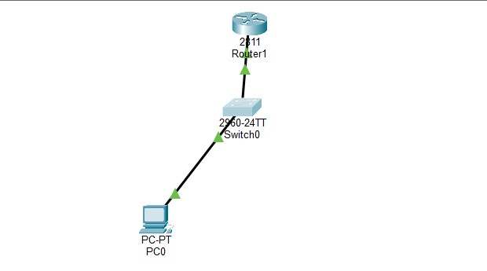

---

## ⚙️ 3. Cisco IOS Command-Line Interface (CLI) Modes

Cisco IOS provides different command-line modes for monitoring, configuration, and administration of network devices.

| CLI Mode | Prompt | Purpose |
|---|---|---|
| User EXEC | `Router>` | Basic monitoring commands |
| Privileged EXEC | `Router#` | Administrative and verification commands |
| Global Configuration | `Router(config)#` | Device-wide configuration |
| Interface Configuration | `Router(config-if)#` | Interface configuration |
| Line Configuration | `Router(config-line)#` | Console and VTY configuration |

### Important Navigation Commands

```cisco
enable
configure terminal
exit
end
```

The `?` command can also be used to display available commands and their options.

---

## 🔧 4. Router Configuration – R1

The router was configured with basic identity, security, interface addressing, and remote management settings.

### Configuration Tasks

- Set router hostname to R1.
- Disabled DNS lookup.
- Configured MOTD security banner.
- Configured enable secret.
- Enabled password encryption.
- Created a local administrator account.
- Configured LAN interface addressing.
- Enabled the interface using `no shutdown`.
- Configured domain name.
- Generated RSA cryptographic keys.
- Enabled SSH version 2.
- Secured console and VTY access.

### Configuration Commands

```cisco
enable
configure terminal

hostname R1
no ip domain-lookup

banner motd # WARNING: Authorized access only. #

enable secret <YOUR_ENABLE_SECRET>
service password-encryption

username admin privilege 15 secret <YOUR_ADMIN_SECRET>

ip domain-name lab.local

interface FastEthernet0/0
 description LAN connection to S1
 ip address 192.168.10.1 255.255.255.0
 no shutdown
exit

crypto key generate rsa modulus 2048
ip ssh version 2

line console 0
 password <YOUR_CONSOLE_PASSWORD>
 login
 logging synchronous
exit

line vty 0 4
 login local
 transport input ssh
 exec-timeout 5 0
exit

end
copy running-config startup-config
```

### Router Configuration Evidence

<!-- SCREENSHOT PLACEHOLDER 02: Insert R1 running configuration screenshot here -->

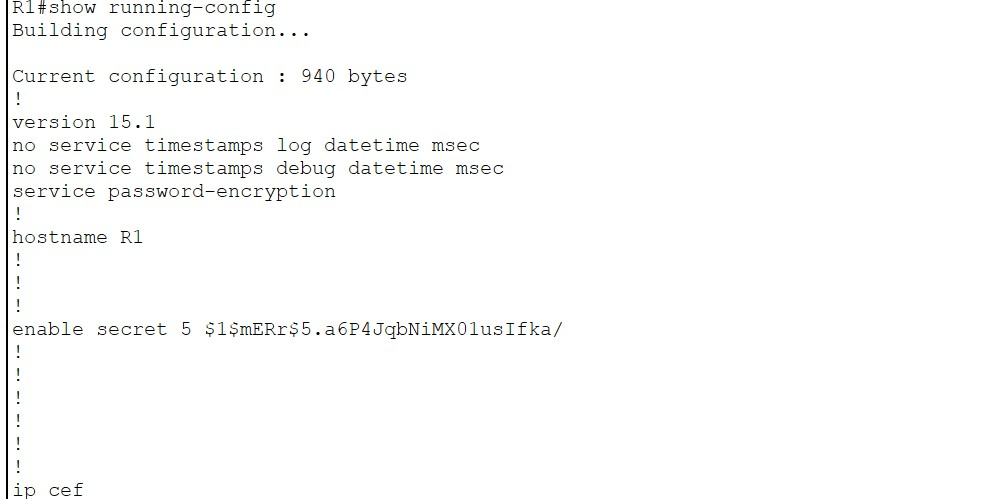
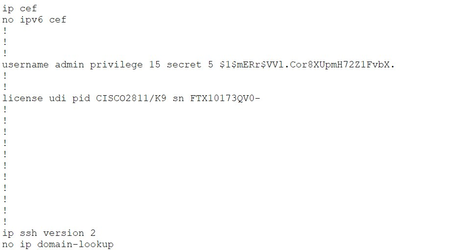
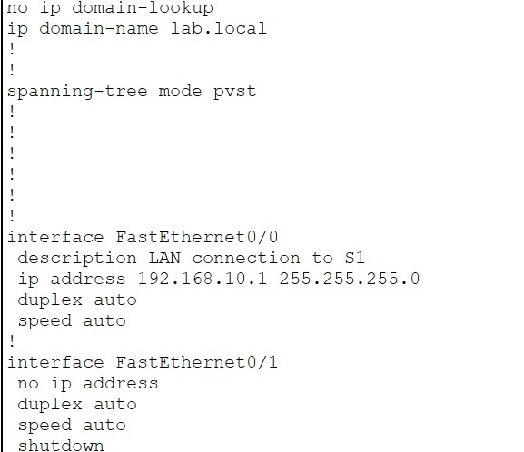
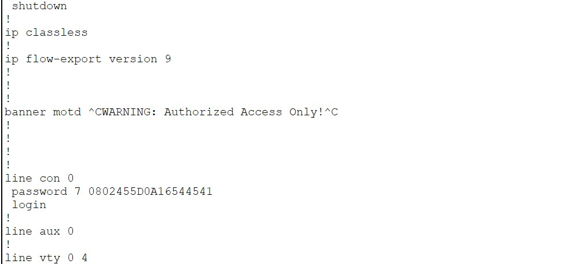
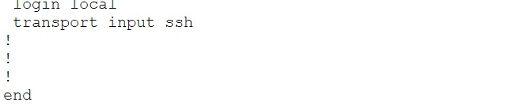
---

## 🔀 5. Switch Configuration – S1

The Layer 2 switch was configured for management connectivity and secure remote administration.

### Configuration Tasks

- Configured switch hostname.
- Disabled DNS lookup.
- Configured security banner.
- Set enable secret and administrator credentials.
- Enabled password encryption.
- Configured VLAN 1 management interface.
- Assigned management IP address.
- Configured default gateway.
- Enabled SSH version 2.
- Secured console and VTY access.

### Configuration Commands

```cisco
enable
configure terminal

hostname S1
no ip domain-lookup

banner motd # WARNING: Authorized access only. #

enable secret <YOUR_ENABLE_SECRET>
service password-encryption

username admin privilege 15 secret <YOUR_ADMIN_SECRET>

ip domain-name lab.local

interface vlan 1
 ip address 192.168.10.2 255.255.255.0
 no shutdown
exit

ip default-gateway 192.168.10.1

crypto key generate rsa modulus 2048
ip ssh version 2

line console 0
 password <YOUR_CONSOLE_PASSWORD>
 login
 logging synchronous
exit

line vty 0 15
 login local
 transport input ssh
 exec-timeout 5 0
exit

end
copy running-config startup-config
```

**Note:** VLAN 1 SVI may remain down until an active physical switch port belonging to that VLAN is available.

### Switch Configuration Evidence

<!-- SCREENSHOT PLACEHOLDER 03: Insert S1 running configuration screenshot here -->

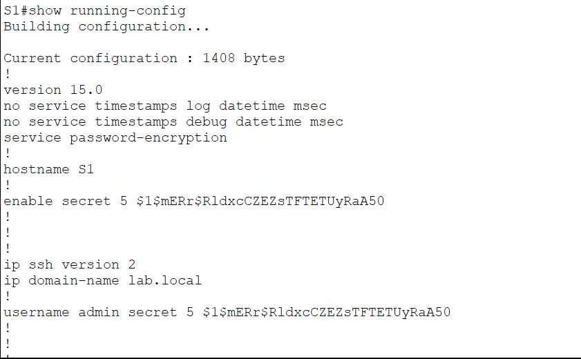
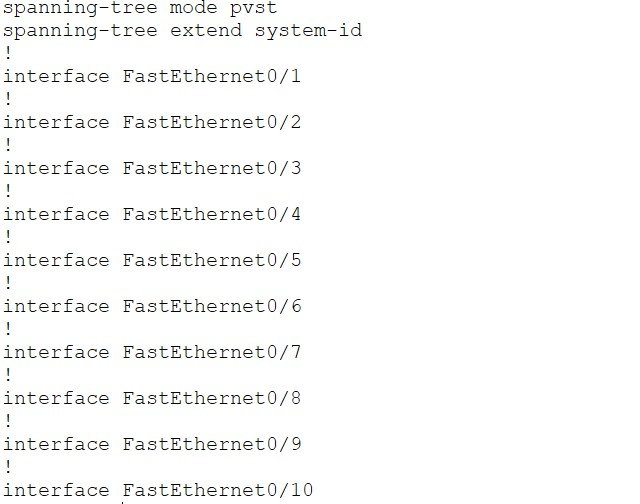
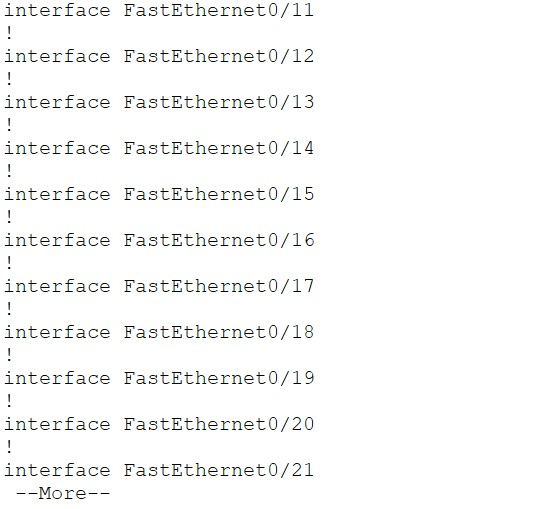
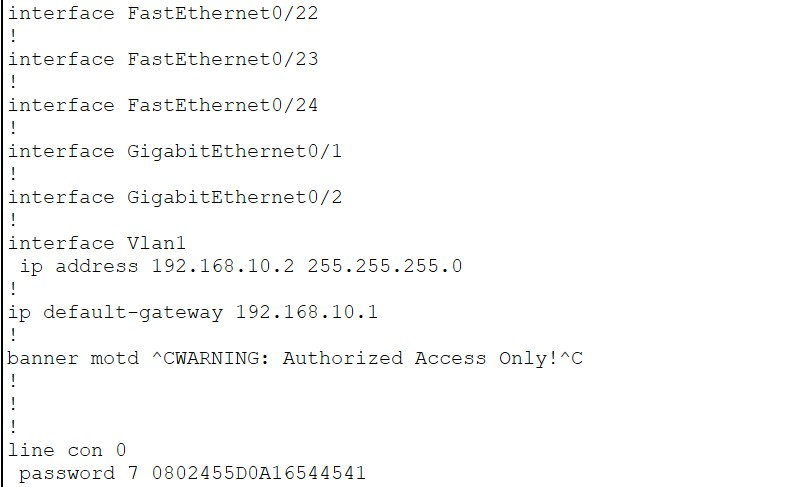
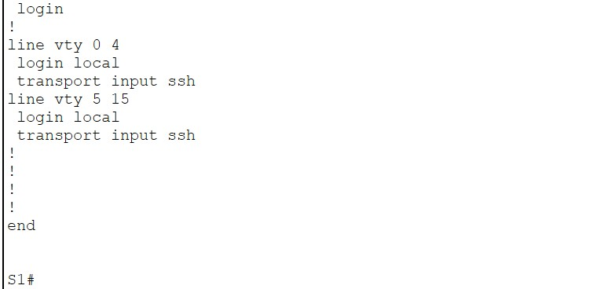


---

## 🔐 6. SSH Configuration and Verification

SSH (Secure Shell) provides encrypted remote access to network devices.

In this task, SSH version 2 was configured on both R1 and S1 using local administrator authentication.

### Verification Commands

```cisco
show ip ssh
show users
```

### Connectivity Testing from PC1

```text
ping 192.168.10.1
ssh -l admin 192.168.10.1
ssh -l admin 192.168.10.2
```

### SSH Verification – Router R1

<!-- SCREENSHOT PLACEHOLDER 04: Insert successful SSH session to R1 from PC1 -->

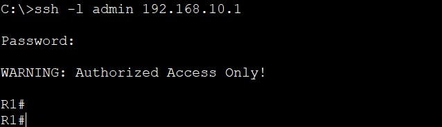

### SSH Verification – Switch S1

<!-- SCREENSHOT PLACEHOLDER 05: Insert successful SSH session to S1 from PC1 -->

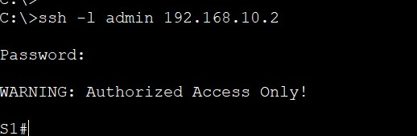

---

## 🔍 7. Essential Cisco IOS Show Commands

During the practical, several essential IOS commands were used to inspect device status, verify interface configurations, and monitor network operations.

### 7.1 show ip interface brief

```cisco
R1# show ip interface brief
```

**Purpose:** Displays interface names, assigned IP addresses, and operational status.

Important fields:

- Interface
- IP-Address
- OK?
- Method
- Status
- Protocol

A properly functioning connected router interface should generally display `up/up`.

<!-- SCREENSHOT PLACEHOLDER 06: Insert actual show ip interface brief output -->

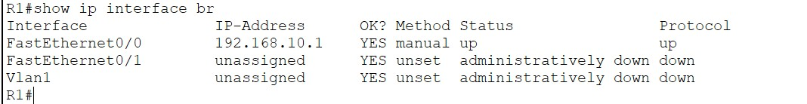

### 7.2 show version

```cisco
R1# show version
```

**Purpose:** Displays important system information, including:

- IOS software version.
- Router platform and model.
- System uptime.
- System image.
- Processor and memory information.
- Configuration register value.

<!-- SCREENSHOT PLACEHOLDER 07: Insert actual show version output -->

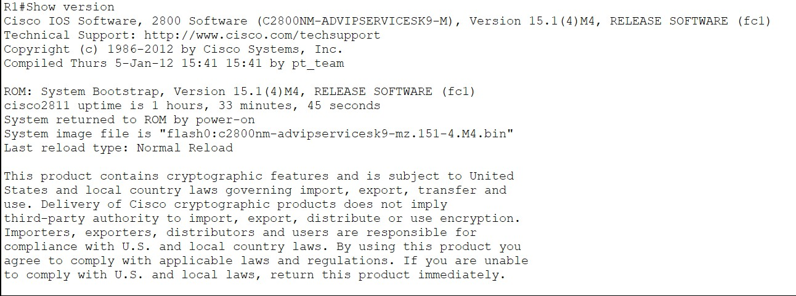
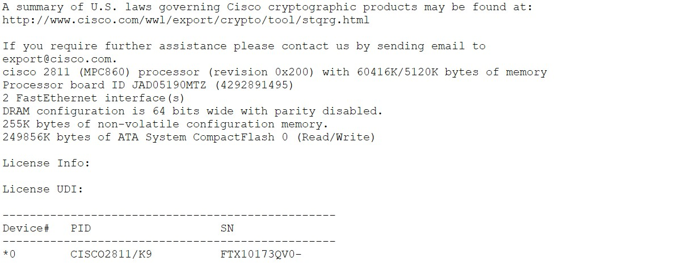
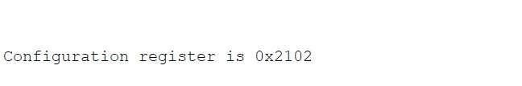
### 7.3 Additional Verification Commands

```cisco
show ip ssh
show interfaces gigabitEthernet 0/0
show startup-config
show users
```

Switch verification:

```cisco
show vlan brief
show interfaces status
```

---

## 💾 8. Saving Configuration and Reload Persistence Test

Cisco IOS uses two important configuration locations:

| Configuration | Description |
|---|---|
| Running Configuration | Active configuration stored in RAM |
| Startup Configuration | Saved configuration stored in NVRAM |

### Saving Configuration

```cisco
R1# copy running-config startup-config
```

This command saves the active configuration so it can be loaded after the device restarts.

### Reload Verification

```cisco
R1# copy running-config startup-config
R1# reload
```

After the router restarted, the following commands were used to verify configuration persistence.

```cisco
R1> enable
R1# show running-config
R1# show ip interface brief
```

### Configuration Save Confirmation

<!-- SCREENSHOT PLACEHOLDER 08: Insert successful copy running-config startup-config confirmation -->

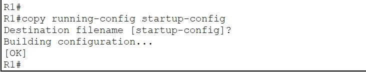

### After-Reload Verification

<!-- SCREENSHOT PLACEHOLDER 09: Insert router output after reload showing preserved configuration -->

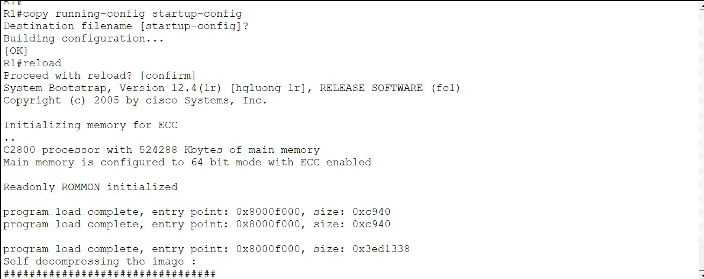
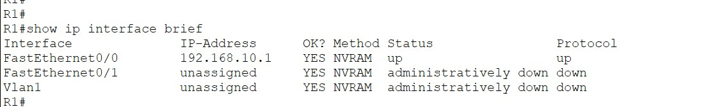
---

## 🔑 9. Password Recovery Using Configuration Register

The password recovery practical demonstrates how a Cisco IOS router can be recovered when administrative credentials are unavailable.

The process uses the configuration register to temporarily bypass loading the startup configuration during boot.

### 9.1 Original Configuration Register

The original configuration register value was checked using:

```cisco
show version
```

The commonly used normal configuration register value is:

```text
0x2102
```

<!-- SCREENSHOT PLACEHOLDER 10: Insert original show version / configuration register evidence -->

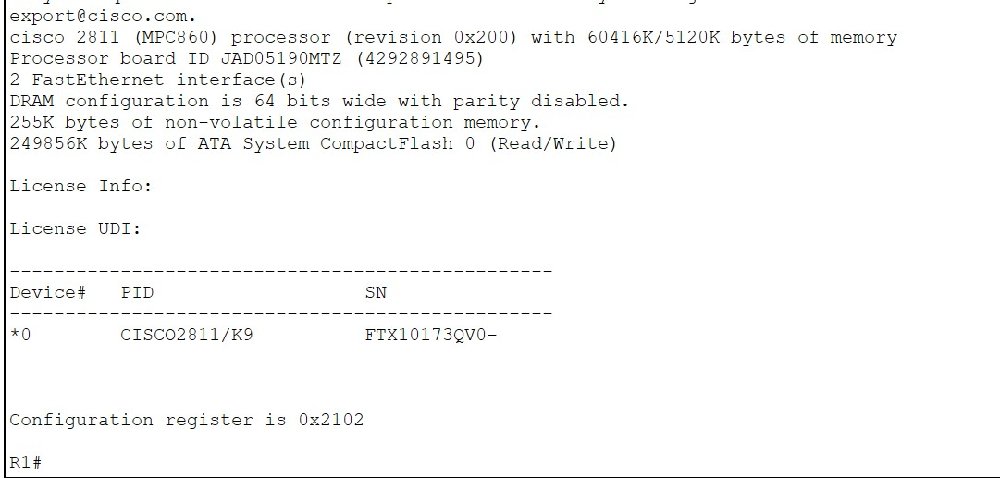

### 9.2 Changing Configuration Register

The router was configured to ignore the startup configuration during the recovery boot process.

ROMMON command:

```text
confreg 0x2142
```

<!-- SCREENSHOT PLACEHOLDER 11: Insert ROMMON screenshot showing confreg 0x2142 -->

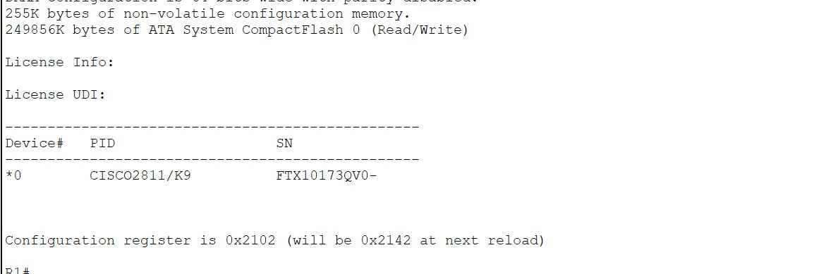

### 9.3 Router Reload After Register Change

The router was restarted using the platform-supported ROMMON command.

```text
reset
```

<!-- SCREENSHOT PLACEHOLDER 12: Insert router reload screenshot after configuration register change -->

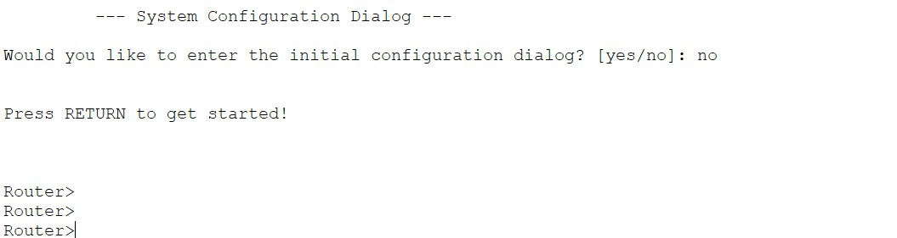

### 9.4 Startup Configuration Ignored

After booting without loading the saved startup configuration, privileged EXEC mode was accessed.

```cisco
Router> enable
```

<!-- SCREENSHOT PLACEHOLDER 13: Insert evidence of router booting without startup configuration -->

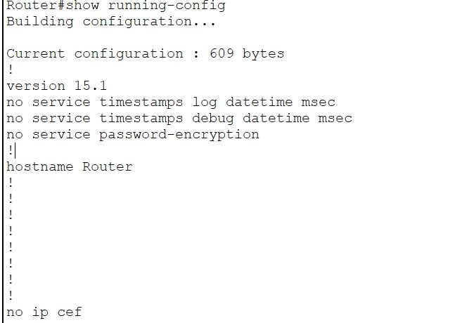
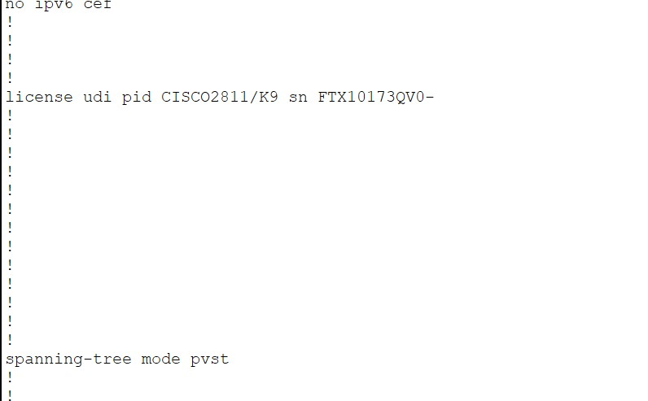
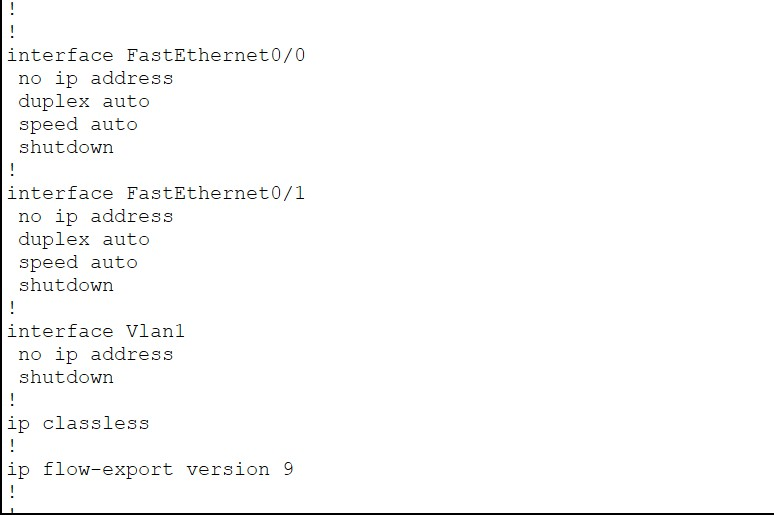
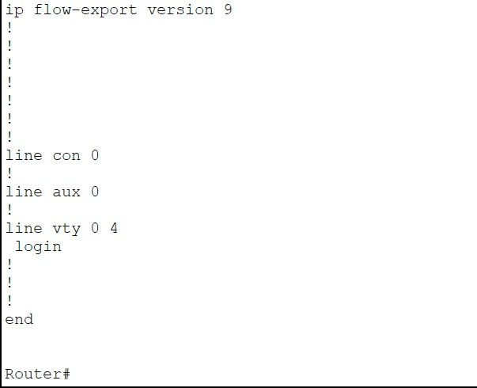
### 9.5 Restoring Startup Configuration

The saved configuration was restored into the running configuration.

```cisco
Router# copy startup-config running-config
```

<!-- SCREENSHOT PLACEHOLDER 14: Insert configuration restoration command and output -->

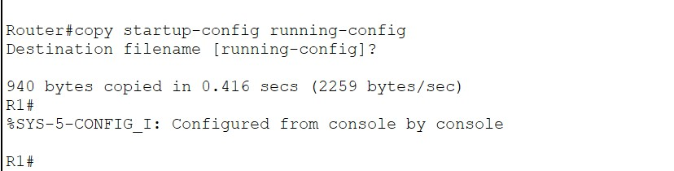

### 9.6 Updating Credentials and Restoring Normal Configuration

New administrative credentials were configured.

```cisco
configure terminal

enable secret <NEW_ENABLE_SECRET>
username admin privilege 15 secret <NEW_ADMIN_SECRET>

line console 0
 password <NEW_CONSOLE_PASSWORD>
 login
exit

line vty 0 4
 login local
 transport input ssh
exit

config-register 0x2102

end
copy running-config startup-config
reload
```

**Important:** The exact break sequence, ROMMON commands, and supported recovery process vary by router platform. This procedure should only be performed on an authorized lab device.

### 9.7 Post-Recovery Login Verification

After completing the recovery process, SSH connectivity was tested again from PC1.

<!-- SCREENSHOT PLACEHOLDER 15: Insert successful SSH login to R1 after password recovery -->

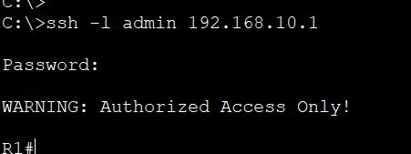

<!-- SCREENSHOT PLACEHOLDER 16: Insert successful SSH login to S1 after password recovery -->

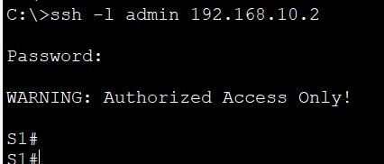

---

## 📊 10. Testing Checklist and Results

The following practical tests were completed and their results were recorded.

| Test | Expected Result | Status |
|---|---|---|
| Hostname and Banner | Correct hostname and banner | PASS |
| Interface Addressing | Correct IP and interface status | PASS |
| SSH to Router | Successful SSH login to R1 | PASS |
| SSH to Switch | Successful SSH login to S1 | PASS |
| Show Commands | Commands executed and outputs captured | PASS |
| Save and Reload | Configuration persists after reload | PASS |
| Password Recovery | Credentials recovered and verified | PASS |

<details>
<summary><b>View Additional Lab Information</b></summary>

**Router:** R1

**Switch:** S1

**PC:** PC1

**Management Subnet:** 192.168.10.0/24

**SSH Version:** 2

**Normal Configuration Register:** 0x2102

**Password Recovery Register:** 0x2142

</details>

---

## 📚 11. Key Learning Outcomes

Through this practical task, I gained hands-on experience in:

- Understanding Cisco IOS CLI modes.
- Configuring Cisco routers and switches.
- Assigning IPv4 addresses to network interfaces.
- Configuring VLAN 1 management interfaces.
- Implementing secure remote access using SSH.
- Generating RSA cryptographic keys.
- Using essential Cisco IOS show commands.
- Saving and verifying network device configurations.
- Understanding RAM and NVRAM configuration storage.
- Performing basic password recovery using ROMMON.
- Understanding configuration register values.
- Verifying network connectivity and troubleshooting configuration issues.

---

## 🏁 12. Conclusion

In this practical lab, I successfully configured the Cisco IOS CLI on both Router R1 and Switch S1. I assigned IP addresses, configured basic security settings, enabled SSH for secure remote access, and verified successful SSH connections to both devices.

I also practiced essential IOS show commands, saved configurations, and verified configuration persistence after reload. During the configuration process, I encountered an issue with RSA key generation, which I resolved by understanding and applying the required domain name configuration.

Finally, I practiced the configuration-register-based password recovery process and verified successful post-recovery login.

Overall, this task strengthened my practical understanding of Cisco IOS commands, network device configuration, remote management, and basic troubleshooting.

---

## 🔒 Security Notice

This repository is intended for educational and lab purposes.

- Never upload real passwords or private keys.
- Replace sample credentials with safe lab credentials.
- Remove sensitive information from configuration screenshots before publishing.
- Perform recovery procedures only on authorized lab devices.

---

## 👨‍💻 Author

**Tahir Mehdi**

CCNA Networking Intern  
TechBiz Security

**Areas of Interest:**
- Computer Networking
- Cisco Routing & Switching
- Network Security
- Cybersecurity
- SOC Operations

---

<p align="center">

**TECHBIZ SECURITY**

*CCNA Networking Internship – Week 1, Task 3*

**Learn • Configure • Verify • Secure**

</p>