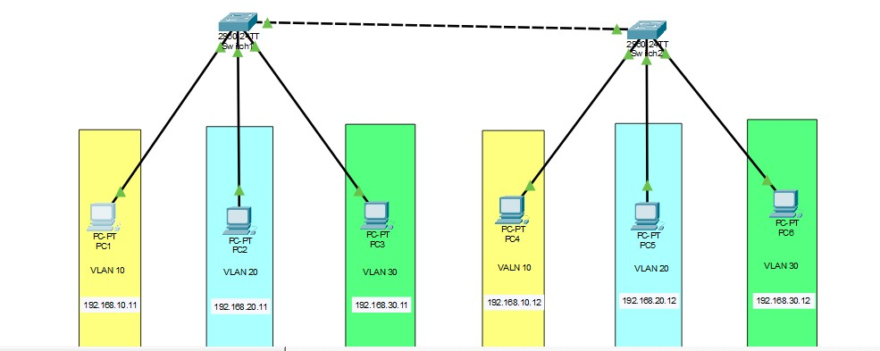

# CCNA Networking Internship — Week 02 | Task 05
## Trunking, IEEE 802.1Q & Native VLAN

<p align="center">
  
  
  
  
</p>

<p align="center">
  <b>Hands-on exploration of VLAN trunking, 802.1Q tagging, allowed VLAN filtering, DTP, and Native VLAN mismatch troubleshooting.</b>
</p>

---

## 📌 Overview

This repository documents my practical work for **Week 02 — Task 05** of the CCNA Networking Internship at **TechBiz Academy**.

In this lab, I configured and tested an IEEE 802.1Q trunk link between two Cisco switches to carry multiple VLANs over a single physical connection. I also investigated how trunk allowed-VLAN restrictions affect connectivity, inspected tagged Ethernet frames in Cisco Packet Tracer Simulation mode, and deliberately created a Native VLAN mismatch to observe and troubleshoot the resulting Layer 2 behavior.

The lab focuses on practical configuration, verification, troubleshooting, and understanding how VLAN traffic is transported between switches.

---

## 🎯 Objectives

- Configure VLANs on Cisco switches.
- Assign switch ports to the appropriate VLANs.
- Establish an IEEE 802.1Q trunk between two switches.
- Configure and verify the trunk's allowed VLAN list.
- Test connectivity with a VLAN deliberately excluded from the trunk.
- Understand the structure and fields of an 802.1Q Ethernet frame.
- Inspect VLAN tags using Packet Tracer Simulation mode.
- Create and troubleshoot a Native VLAN mismatch.
- Restore a consistent Native VLAN configuration.
- Understand Dynamic Trunking Protocol (DTP) modes and negotiation.

---

## 🧪 Lab Environment

| Component | Details |
|---|---|
| Simulation Software | Cisco Packet Tracer |
| Network Devices | 2 Cisco Layer 2 switches |
| End Devices | 6 PCs |
| Switching Technology | VLANs and Ethernet trunking |
| Trunk Protocol | IEEE 802.1Q |
| Trunk Interface | FastEthernet0/24 |
| VLANs | 10, 20, 30, 99 |
| Testing Method | ICMP Ping & Packet Tracer Simulation |
| Organization | TechBiz Academy |
| Internship | CCNA Networking Internship |

---

## 🗺️ Network Topology

The lab consists of two switches connected through a trunk link. Each switch has three end devices, with one device assigned to each user VLAN.

The trunk carries VLAN 10, VLAN 20, and VLAN 30. VLAN 99 is configured as the Native VLAN.

### Topology Diagram

<!-- SCREENSHOT PLACEHOLDER: Replace with your actual Packet Tracer topology screenshot -->



---

## 🏷️ VLAN Configuration

The following VLANs were created and configured across both switches.

| VLAN ID | VLAN Name | Subnet | Purpose |
|---|---|---|---|
| 10 | ADMIN | `192.168.10.0/24` | Administration users |
| 20 | STUDENT | `192.168.20.0/24` | Student devices |
| 30 | GUEST | `192.168.30.0/24` | Guest devices |
| 99 | NATIVE | No user subnet | Native VLAN for trunk links |

### VLAN Architecture

- **VLAN 10 — ADMIN:** Administration network
- **VLAN 20 — STUDENT:** Student network
- **VLAN 30 — GUEST:** Guest network
- **VLAN 99 — NATIVE:** Dedicated Native VLAN

---

## 💻 IP Addressing Plan

Each VLAN uses a separate IPv4 subnet. Devices in the same VLAN are configured within the same subnet to perform end-to-end connectivity tests across the switches.

| Device | VLAN | IP Address | Subnet Mask |
|---|---:|---|---|
| PC1 | 10 | `192.168.10.11` | `255.255.255.0` |
| PC2 | 20 | `192.168.20.11` | `255.255.255.0` |
| PC3 | 30 | `192.168.30.11` | `255.255.255.0` |
| PC4 | 10 | `192.168.10.12` | `255.255.255.0` |
| PC5 | 20 | `192.168.20.12` | `255.255.255.0` |
| PC6 | 30 | `192.168.30.12` | `255.255.255.0` |

---

## ⚙️ 1. VLAN Creation & Access-Port Configuration

The VLANs were created on both switches, and the end-device interfaces were configured as access ports.

### VLAN Creation

```cisco
enable
configure terminal

vlan 10
 name ADMIN

vlan 20
 name STUDENT

vlan 30
 name GUEST

vlan 99
 name NATIVE

end
```

### Access-Port Assignment

```cisco
configure terminal

interface fastethernet 0/2
 switchport mode access
 switchport access vlan 10

interface fastethernet 0/3
 switchport mode access
 switchport access vlan 20

interface fastethernet 0/4
 switchport mode access
 switchport access vlan 30

end
```

### Verification

```cisco
show vlan brief
```

The command was used to verify VLAN creation and access-port membership.

<!-- SCREENSHOT PLACEHOLDER: Replace with your show vlan brief screenshot -->


---

## 🔗 2. Configure the IEEE 802.1Q Trunk

The inter-switch link was configured as a static trunk. The trunk carries multiple VLANs over one physical Ethernet connection.

### Trunk Configuration

Applied to the inter-switch interface on both switches:

```cisco
enable
configure terminal

interface fastethernet 0/24
 switchport mode trunk
 switchport trunk allowed vlan 10,20,30
 switchport trunk native vlan 99
 no shutdown

end
```

### Configuration Details

| Command | Purpose |
|---|---|
| `switchport mode trunk` | Forces the interface into trunk mode |
| `switchport trunk allowed vlan 10,20,30` | Permits VLANs 10, 20 and 30 |
| `switchport trunk native vlan 99` | Sets VLAN 99 as the Native VLAN |
| `no shutdown` | Enables the interface |

> **Note:** The actual trunk interface verified in my Packet Tracer lab was `Fa0/24` on both switches.

### Trunk Verification

```cisco
show interfaces trunk
```

<!-- SCREENSHOT PLACEHOLDER: Replace with the trunk configuration screenshot -->


<!-- SCREENSHOT PLACEHOLDER: Replace with show interfaces trunk output -->


---

## 🚦 3. Allowed VLAN List Testing

An allowed VLAN list determines which VLAN traffic is permitted to cross a trunk link.

Initially, VLANs 10, 20 and 30 were permitted. I then deliberately removed VLAN 30 from the allowed list to test its effect on network connectivity.

### Restrict VLANs on the Trunk

```cisco
configure terminal

interface fastethernet 0/24
 switchport trunk allowed vlan 10,20

end
```

### Verify the Restriction

```cisco
show interfaces trunk
```

### Test Results

| VLAN | Test | Result |
|---|---|---|
| VLAN 10 | PC1 → PC4 | Successful |
| VLAN 20 | PC2 → PC5 | Successful |
| VLAN 30 | PC3 → PC6 while excluded | Failed — 100% packet loss |

When VLAN 30 was removed from the allowed VLAN list, its traffic could not cross the trunk link. The ping test between PC3 and PC6 failed, while the other tested VLANs remained operational.

<!-- SCREENSHOT PLACEHOLDER: Allowed VLAN list restricted to VLAN 10 and 20 -->


<!-- SCREENSHOT PLACEHOLDER: PC3 to PC6 ping failure -->


### Restore the Allowed VLAN List

```cisco
configure terminal

interface fastethernet 0/24
 switchport trunk allowed vlan 10,20,30

end
```

> VLAN 30 restoration is included in the configuration procedure. The original lab report notes that the restoration connectivity test still requires confirmation.

---

## 🧬 4. Understanding IEEE 802.1Q VLAN Tagging

IEEE 802.1Q inserts a **4-byte VLAN tag** into an Ethernet frame. This tag is placed between the Source MAC Address and the original Type/Length field.

### Ethernet Frame Structure

| Field | Size |
|---|---:|
| Destination MAC | 6 bytes |
| Source MAC | 6 bytes |
| 802.1Q VLAN Tag | 4 bytes |
| Type / Length | 2 bytes |
| Payload | Variable |
| FCS | 4 bytes |

### Structure of the 802.1Q Tag

The 4-byte tag consists of two fields:

| Field | Size | Description |
|---|---:|---|
| TPID | 16 bits | Identifies an 802.1Q-tagged frame; typically `0x8100` |
| TCI | 16 bits | Contains PCP, DEI, and VLAN ID |

The Tag Control Information (TCI) is further divided into:

| TCI Field | Size | Purpose |
|---|---:|---|
| PCP (Priority Code Point) | 3 bits | Layer 2 traffic priority / QoS |
| DEI (Drop Eligible Indicator) | 1 bit | Indicates drop eligibility during congestion |
| VID (VLAN Identifier) | 12 bits | Identifies the VLAN |

### 802.1Q Tag Overview

```text
┌───────────────────────────────────────────────────────────────┐
│                     802.1Q VLAN TAG                        │
├───────────────────────────┬───────────────────────────────────┤
│ TPID                    │ TCI                               │
│ 16 Bits                  │ 16 Bits                          │
│ 0x8100                  │ PCP | DEI | VLAN ID               │
└───────────────────────────┴───────────────────────────────────┘

TCI:
┌──────────┬──────┬────────────────────────────────────────────┐
│ PCP 3bit │ DEI  │ VID 12bit                              │
└──────────┴──────┴────────────────────────────────────────────┘
```

---

## 🔍 5. Inspecting a Tagged Frame in Packet Tracer

Using Simulation mode, I inspected an Ethernet frame traveling through the trunk link and verified the 802.1Q tagging information.

### Captured Frame Values

| Field | Captured Value |
|---|---|
| TPID | `0x8100` |
| TCI | `0x000A` |
| PCP | `0` |
| DEI | `0` |
| VLAN ID (VID) | `10` |

The captured frame belonged to VLAN 10. The VLAN tag confirmed that the Ethernet frame was identified as VLAN 10 traffic while crossing the trunk.

<!-- SCREENSHOT PLACEHOLDER: Replace with your Packet Tracer 802.1Q frame capture -->


---

## ⚠️ 6. Native VLAN Mismatch Demonstration

The Native VLAN is the VLAN whose traffic is carried untagged across an IEEE 802.1Q trunk by default.

For proper trunk operation, both ends should use the same Native VLAN.

In this experiment, I intentionally configured different Native VLANs on the two switches.

### Switch 1 — Native VLAN 99

```cisco
configure terminal

interface fastethernet 0/24
 switchport trunk native vlan 99

end
```

### Switch 2 — Native VLAN 1

```cisco
configure terminal

interface fastethernet 0/24
 switchport trunk native vlan 1

end
```

### Verify the Mismatch

```cisco
show interfaces trunk
show logging
```

### Observed Configuration

| Switch | Trunk Interface | Native VLAN |
|---|---|---:|
| Switch 1 | Fa0/24 | 99 |
| Switch 2 | Fa0/24 | 1 |

The switches were operating with inconsistent Native VLAN settings.

<!-- SCREENSHOT PLACEHOLDER: Show Native VLAN 99 on Switch 1 -->


<!-- SCREENSHOT PLACEHOLDER: Show Native VLAN 1 on Switch 2 -->


---

## 🛠️ 7. Troubleshooting Native VLAN Mismatch

### Symptoms & Log Messages

During the mismatch test, the switch logs showed Native VLAN and STP-related inconsistency warnings, including:

- Native VLAN mismatch detected
- Inconsistent peer VLAN information
- STP inconsistency and blocking behavior
- Link and protocol state changes

The captured logs included messages such as:

```text
%CDP-4-NATIVE_VLAN_MISMATCH:
Native VLAN mismatch discovered on FastEthernet0/24
```

And STP-related warnings indicating inconsistent VLAN information on the trunk.

<!-- SCREENSHOT PLACEHOLDER: Native VLAN mismatch log evidence -->


### Why the Mismatch Is a Problem

If one switch sends untagged traffic using VLAN 99 as its Native VLAN, while the other switch expects VLAN 1, the untagged traffic can be assigned to a different broadcast domain at the receiving end.

This can result in:

- Unexpected Layer 2 behavior
- Connectivity disruption
- STP blocking or inconsistency
- Incorrect VLAN traffic classification
- Potential security risks caused by improper Native VLAN design

---

## ✅ 8. Correcting the Native VLAN Mismatch

To fix the mismatch, I configured Native VLAN 99 on both switches.

### Correct Configuration

Apply on **both switches**:

```cisco
configure terminal

vlan 99
 name NATIVE

interface fastethernet 0/24
 switchport mode trunk
 switchport trunk native vlan 99

end
```

### Verification Commands

```cisco
show interfaces trunk
show logging
```

### Final Trunk Configuration

| Switch | Interface | Mode | Native VLAN | Allowed VLANs |
|---|---|---|---:|---|
| Switch 1 | Fa0/24 | Trunk | 99 | 10, 20, 30 |
| Switch 2 | Fa0/24 | Trunk | 99 | 10, 20, 30 |

After correcting the configuration, both switches showed Native VLAN 99, and the trunk link was verified as operational.

<!-- SCREENSHOT PLACEHOLDER: Final trunk verification on Switch 1 -->


<!-- SCREENSHOT PLACEHOLDER: Final trunk verification on Switch 2 -->


---

## 🔄 9. Dynamic Trunking Protocol (DTP)

Dynamic Trunking Protocol (DTP) is a Cisco-proprietary protocol used on supported switch interfaces to negotiate trunking.

### Common DTP Modes

| Mode | Behavior |
|---|---|
| Access | Forces the interface to operate as an access port |
| Trunk | Forces the interface into trunk mode |
| Dynamic Desirable | Actively attempts to negotiate a trunk |
| Dynamic Auto | Passively waits for trunk negotiation |

### DTP Behavior

- **Dynamic Desirable + Dynamic Auto:** Can form a trunk.
- **Dynamic Desirable + Dynamic Desirable:** Can form a trunk.
- **Dynamic Auto + Dynamic Auto:** Normally does not initiate trunking.
- **Static Trunk:** Explicitly forces trunk operation.

For controlled switch-to-switch links, static trunk configuration provides predictable behavior.

### Disable DTP Negotiation

Where supported, DTP negotiation can be disabled on a statically configured trunk:

```cisco
configure terminal

interface fastethernet 0/24
 switchport mode trunk
 switchport nonegotiate

end
```

<!-- SCREENSHOT PLACEHOLDER: DTP modes or switchport details -->


<!-- SCREENSHOT PLACEHOLDER: Negotiation disabled verification -->


---

## 🧪 10. Connectivity & Verification

The lab was verified using switch CLI commands and end-device connectivity tests.

### Verification Commands

```cisco
show vlan brief
show interfaces trunk
show interfaces fastethernet 0/24 switchport
show logging
```

### Connectivity Tests

| Test | Expected Behavior | Observed Result |
|---|---|---|
| PC1 → PC4 (VLAN 10) | Successful | 0% packet loss |
| PC2 → PC5 (VLAN 20) | Successful | Connectivity verified |
| PC3 → PC6 (VLAN 30 excluded) | Failure | 100% packet loss |
| Native VLAN mismatch | Warning / inconsistency | Observed in logs |
| Native VLAN correction | Consistent Native VLAN | VLAN 99 verified on both switches |
| 802.1Q frame inspection | Tag visible | TPID `0x8100`, VID 10 |

<!-- SCREENSHOT PLACEHOLDER: Final successful VLAN 10 connectivity -->


---

## 📊 Lab Results Summary

| Task | Status |
|---|---|
| VLAN 10, 20, 30 and 99 creation | ✅ Completed |
| Access-port VLAN assignment | ✅ Completed |
| 802.1Q trunk configuration | ✅ Completed |
| Allowed VLAN configuration | ✅ Completed |
| VLAN 30 allowed-list restriction | ✅ Tested |
| VLAN 30 ping failure while excluded | ✅ Verified |
| 802.1Q frame inspection | ✅ Completed |
| Native VLAN mismatch demonstration | ✅ Completed |
| Native VLAN mismatch log analysis | ✅ Completed |
| Native VLAN mismatch correction | ✅ Completed |
| Trunk verification after correction | ✅ Completed |
| DTP investigation | ✅ Completed |
| VLAN 30 restoration connectivity test | 📝 Requires confirmation |

---

## 🧠 Key Learnings

Through this practical lab, I learned:

- How VLANs separate devices into different Layer 2 broadcast domains.
- How trunk links carry multiple VLANs over a single physical link.
- How IEEE 802.1Q tagging identifies VLAN traffic.
- The purpose of TPID, TCI, PCP, DEI, and VID.
- How allowed VLAN lists control traffic permitted across a trunk.
- How to inspect Ethernet frames in Packet Tracer Simulation mode.
- Why Native VLAN settings must match on both trunk endpoints.
- How CDP and STP logs help identify trunk inconsistencies.
- How to troubleshoot and restore a misconfigured trunk.
- The difference between static trunking and DTP negotiation.

---

## 📝 Conclusion

This practical exercise provided hands-on experience with Cisco switch trunking and VLAN transport.

I successfully configured an 802.1Q trunk between two switches, verified VLAN membership and allowed VLAN filtering, inspected VLAN tags in captured Ethernet frames, and demonstrated how a Native VLAN mismatch can trigger Layer 2 inconsistency warnings.

The troubleshooting process reinforced the importance of matching Native VLAN settings, verifying trunk configuration on both endpoints, and validating network behavior through real connectivity tests rather than relying on configuration commands alone.

---

## 📁 Repository Structure

```text
CCNA-Internship/
└── Week-02/
    └── Task-05/
        ├── README.md
        └── Screenshots/
            ├── 01-Network-Topology.png
            ├── 02-VLAN-Database.png
            ├── 03-Trunk-Configuration.png
            ├── 04-Trunk-Verification.png
            ├── 05-Allowed-VLAN-Restriction.png
            ├── 06-VLAN-30-Ping-Failure.png
            ├── 07-8021Q-Frame-Capture.png
            ├── 08-Native-VLAN-Switch1.png
            ├── 09-Native-VLAN-Switch2.png
            ├── 10-Native-VLAN-Mismatch-Logs.png
            ├── 11-Native-VLAN-Fixed-Switch1.png
            ├── 12-Native-VLAN-Fixed-Switch2.png
            ├── 13-DTP-Configuration.png
            ├── 14-DTP-Disabled.png
            └── 15-Connectivity-Verification.png
```

---

## 👨‍💻 Author

**Tahir Mehdi**

- 🎓 CCNA Networking Internship
- 🏢 TechBiz Academy
- 📅 Week 02 — Task 05
- 📌 Topic: Trunking, IEEE 802.1Q & Native VLAN

---

<p align="center">
  <b>Learning by configuring. Growing by troubleshooting. Building networking skills one lab at a time. 🚀</b>
</p>
